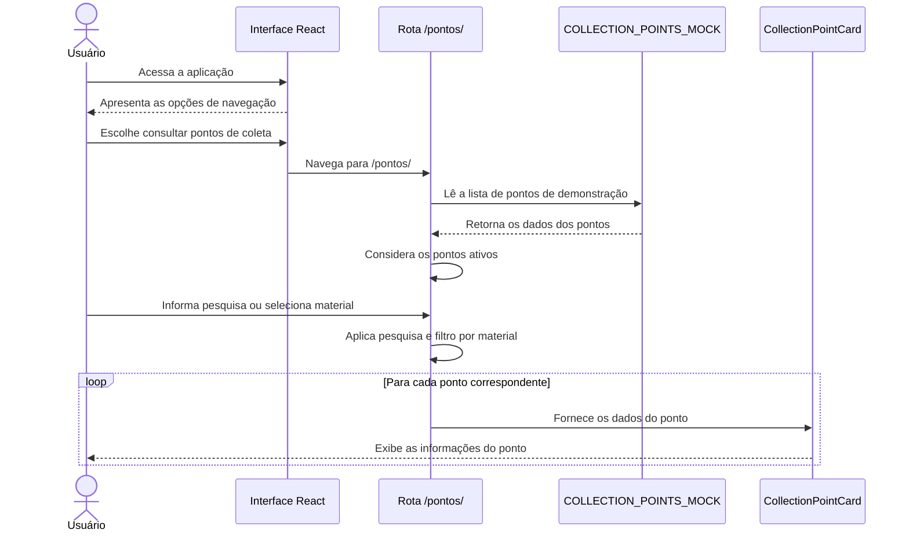
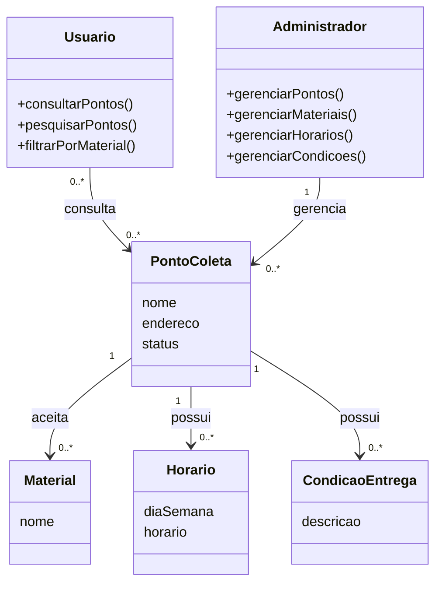

# Modelagem do sistema

> **Artefato central da Sprint 3, atualizado na Sprint 4 para refletir a implementação atual do Coleta+.**
>
> **Nota de atualização:** a versão inicial da modelagem descrevia uma interface estática em HTML, CSS e JavaScript. O frontend atual foi reorganizado em React e TypeScript. Por isso, o fluxo comportamental e a correspondência entre modelo e código foram atualizados para apontar para a rota, os componentes, os dados de demonstração e os tipos atualmente utilizados. O modelo de domínio continua conceitual e não significa que todas as funcionalidades administrativas já estejam implementadas.

## 1. Modelos selecionados

| Modelo | Tipo | Pergunta que ele ajuda a responder | Requisitos relacionados |
|---|---|---|---|
| Fluxo de consulta e filtragem dos pontos de coleta | Comportamental | Como o usuário abre a página de pontos, consulta as informações e utiliza a pesquisa e os filtros disponíveis? | RF-01, RF-02, RF-03, RF-04, RF-05 |
| Modelo de domínio dos pontos de coleta | Estrutural | Quais são os principais conceitos do domínio e como pontos de coleta, materiais, horários e condições de entrega se relacionam? | RF-01, RF-02, RF-03, RF-04, RF-05, RF-07, RF-08, RF-09, RF-10, RF-11, RF-12 |

## 2. Modelo comportamental em Mermaid

**Descrição e decisões representadas:** o modelo comportamental representa o fluxo de consulta disponibilizado pelo frontend atual. O usuário acessa a interface e navega para a rota `/pontos/`. Essa página utiliza a lista de demonstração `COLLECTION_POINTS_MOCK`, considera os pontos ativos e permite pesquisar e filtrar os resultados por material. Os resultados são apresentados por meio do componente reutilizável `CollectionPointCard`.

O diagrama representa o comportamento observado na implementação React e TypeScript. Ele **não representa uma chamada a uma API nem uma consulta a banco de dados**: os dados usados nesse fluxo são dados de demonstração mantidos no frontend. O modelo poderá ser atualizado quando a origem dos dados for integrada a um serviço ou backend.

## 3. Modelo estrutural em Mermaid

**Descrição e decisões representadas:** o modelo estrutural apresenta os conceitos centrais do domínio do Coleta+. `Usuario` representa quem consulta os pontos disponíveis. `PontoColeta` representa o local de recebimento de resíduos eletrônicos. `Material`, `Horario` e `CondicaoEntrega` representam, respectivamente, os materiais aceitos, os horários de funcionamento e as condições para entrega.

`Administrador` representa o perfil responsável pelo gerenciamento previsto nos requisitos. Sua presença no modelo é conceitual: a implementação do fluxo React de consulta descrita neste documento não comprova que as funcionalidades administrativas estejam implementadas.

O modelo é de domínio, não um diagrama literal das classes TypeScript. Ele descreve conceitos e relacionamentos sem afirmar que cada conceito corresponda a uma classe independente no código ou a uma tabela de banco de dados.

## 4. Relação entre requisitos e modelos

| Requisito | Elemento do modelo | Como está representado | Situação na implementação atual / rastreabilidade |
|---|---|---|---|
| RF-01 | Usuario / PontoColeta | Usuário consulta a lista de pontos de coleta disponíveis | Fluxo da rota de pontos e apresentação dos resultados; Issues [#31](https://github.com/lucasensousa/coleta-mais/issues/31), [#33](https://github.com/lucasensousa/coleta-mais/issues/33) e [#37](https://github.com/lucasensousa/coleta-mais/issues/37) |
| RF-02 | Material | Materiais aceitos são associados a cada ponto e podem ser utilizados no filtro | Dados e filtro por material no frontend; Issues [#32](https://github.com/lucasensousa/coleta-mais/issues/32), [#33](https://github.com/lucasensousa/coleta-mais/issues/33) e [#37](https://github.com/lucasensousa/coleta-mais/issues/37) |
| RF-03 | Horario | Horários são representados como informações associadas ao ponto | Horários são lidos dos dados de demonstração e apresentados no componente `CollectionPointCard`. |
| RF-04 | CondicaoEntrega | Condições de entrega são representadas como informações associadas ao ponto | Condições são lidas dos dados de demonstração e apresentadas no componente `CollectionPointCard`. |
| RF-05 | PontoColeta | A identificação e a localização são informações do ponto de coleta | O cartão exibe endereço, bairro quando disponível, cidade e estado. |
| RF-07 | Administrador / PontoColeta | Administrador gerencia o cadastro de pontos | Modelo conceitual relacionado aos requisitos; não comprovado pelo fluxo de consulta atual |
| RF-08 | Administrador / PontoColeta | Administrador gerencia informações dos pontos | Modelo conceitual relacionado aos requisitos; não comprovado pelo fluxo de consulta atual |
| RF-09 | PontoColeta | O estado do ponto é representado pelo atributo conceitual `status` | A consulta considera pontos ativos; isso não comprova uma interface para alterar o estado do ponto |
| RF-10 | Administrador / Material | Administrador gerencia os materiais associados aos pontos | Modelo conceitual relacionado aos requisitos; não comprovado pelo fluxo de consulta atual |
| RF-11 | Administrador / Horario | Administrador gerencia os horários dos pontos | Modelo conceitual relacionado aos requisitos; não comprovado pelo fluxo de consulta atual |
| RF-12 | Administrador / CondicaoEntrega | Administrador gerencia as condições associadas aos pontos | Modelo conceitual relacionado aos requisitos; não comprovado pelo fluxo de consulta atual |

## 5. Correspondência entre o modelo e o código atual

| Elemento modelado | Arquivo/diretório correspondente | Observação |
|---|---|---|
| Página/rota de consulta | [`frontend/src/routes/pontos/index.tsx`](../../frontend/src/routes/pontos/index.tsx) | Implementa a página React associada à rota `/pontos/`, incluindo a consulta e a aplicação dos filtros disponíveis. |
| Cartão de ponto de coleta | [`frontend/src/components/pontos/CollectionPointCard.tsx`](../../frontend/src/components/pontos/CollectionPointCard.tsx) | Componente reutilizável responsável pela apresentação das informações de cada ponto. |
| Dados dos pontos de demonstração | [`frontend/src/data/collectionPointsMock.ts`](../../frontend/src/data/collectionPointsMock.ts) | Mantém os dados de demonstração utilizados pela página. Não representa, por si só, persistência em banco de dados. |
| Tipo dos dados de ponto | [`frontend/src/types/collectionPoint.ts`](../../frontend/src/types/collectionPoint.ts) | Define a tipagem TypeScript utilizada para representar os dados dos pontos. |
| Usuario | Interface web e fluxo da rota de consulta | É representado como ator que utiliza a interface; não é necessário que exista uma classe `Usuario` no frontend. |
| PontoColeta | Tipo dos dados e objetos em `collectionPointsMock.ts` | O conceito de ponto de coleta aparece nos dados usados pela página. O modelo conceitual não exige que exista uma classe com o mesmo nome. |
| Material | Dados do ponto, tipo TypeScript e filtro da página | Representa os materiais associados aos pontos e utilizados na consulta. |
| Horario e CondicaoEntrega | [`CollectionPointCard.tsx`](../../frontend/src/components/pontos/CollectionPointCard.tsx) e [`collectionPointsMock.ts`](../../frontend/src/data/collectionPointsMock.ts) | Horários e condições são fornecidos pelos dados de demonstração e exibidos no cartão. |
| Administrador | [`docs/requisitos/requisitos.md`](../requisitos/requisitos.md) | O perfil e suas responsabilidades são previstos nos requisitos. Esta referência documental não comprova, por si só, a existência de uma interface administrativa implementada. |

## 6. Refinamentos identificados

- **Atualização do fluxo comportamental:** o fluxo antigo, que apontava para `pontos.html`, foi atualizado para representar a navegação pela rota React `/pontos/`.
- **Separação de responsabilidades:** a página de consulta, o cartão de ponto, os dados de demonstração e os tipos TypeScript estão organizados em módulos distintos, permitindo localizar separadamente a interface, a apresentação, os dados e a tipagem.
- **Pesquisa e filtragem:** o fluxo comportamental passou a representar a consulta de pontos ativos, a pesquisa textual e o filtro por material presentes no frontend atual.
- **Limite dos dados:** o uso de `COLLECTION_POINTS_MOCK` foi registrado explicitamente. O fluxo documentado não presume comunicação com API ou banco de dados.
- **Domínio administrativo:** as responsabilidades do administrador foram mantidas no modelo conceitual por estarem relacionadas aos requisitos, mas foram diferenciadas da funcionalidade pública de consulta representada no código atual.
- **Coerência documental:** os caminhos antigos `src/index.html`, `src/pontos.html` e `src/pontos.js` foram substituídos pelos caminhos do frontend React/TypeScript atual.

## 7. Histórico de atualização

| Sprint | Modelo/artefato alterado | Motivo | Evidência |
|---|---|---|---|
| Sprint 3 | Modelo comportamental — fluxo de consulta de pontos | Representar a sequência inicial de interações do usuário durante a consulta dos pontos | [Issue #31](https://github.com/lucasensousa/coleta-mais/issues/31) |
| Sprint 3 | Modelo estrutural — domínio dos pontos de coleta | Representar os principais conceitos e relacionamentos do domínio | [Issue #32](https://github.com/lucasensousa/coleta-mais/issues/32) |
| Sprint 3 | Estrutura de dados e fluxo de consulta | Adequar a implementação inicial aos modelos definidos | [Issue #33](https://github.com/lucasensousa/coleta-mais/issues/33) |
| Sprint 3 | Documentação da modelagem e rastreabilidade | Registrar os modelos, relacionamentos e evidências da sprint | [Issue #34](https://github.com/lucasensousa/coleta-mais/issues/34) |
| Sprint 4 | Atualização da correspondência entre modelo e código | Refletir a migração da interface estática para React/TypeScript e documentar os módulos atuais, sem afirmar integração de dados que não está demonstrada | [Issue #37 — T-06](https://github.com/lucasensousa/coleta-mais/issues/37) e [Issue #38 — D-06](https://github.com/lucasensousa/coleta-mais/issues/38) |
| Sprint 4 | Modelos comportamental e estrutural e correspondência com o código | Atualizar a documentação após a migração do frontend para React/TypeScript, distinguindo comportamentos implementados de funcionalidades apenas previstas | [Issue #39](https://github.com/lucasensousa/coleta-mais/issues/39) |
