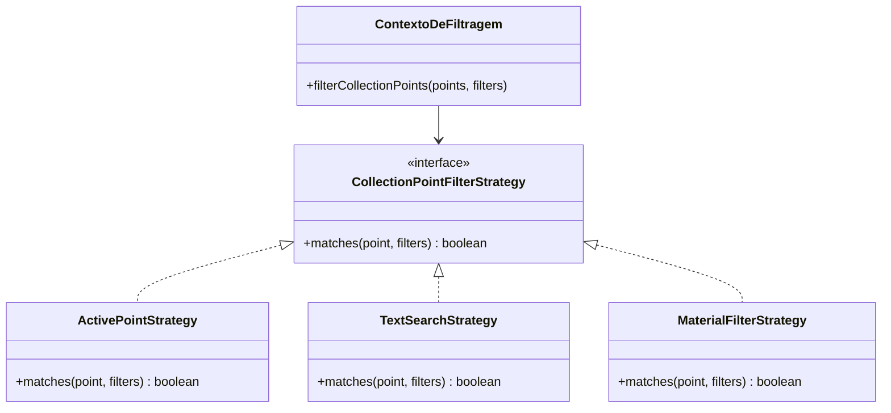

# Padrões de projeto aplicados

> Artefato central da Sprint 5 do Coleta+.

## 1. Problema recorrente identificado

Na implementação anterior, os critérios de filtragem dos pontos de coleta estavam concentrados na página React. A mesma função verificava o status do ponto, a correspondência do texto pesquisado e o material selecionado.

Essa organização dificultava a evolução independente das regras de filtragem e concentrava diferentes responsabilidades no mesmo trecho de código.

## 2. Padrão aplicado

### PP-01 — Strategy

- **Problema que resolve:** separar os algoritmos utilizados para filtrar os pontos de coleta.
- **Contexto no projeto:** consulta de pontos de coleta do Coleta+.
- **Participantes:**
  - `CollectionPointFilterStrategy`
  - `ActivePointStrategy`
  - `TextSearchStrategy`
  - `MaterialFilterStrategy`
  - `filterCollectionPoints`
- **Requisitos relacionados:** RF-01 e RF-02.
- **Issue de implementação:** preencher com o link da Issue T-07.

## 3. Estrutura do padrão

O contexto do diagrama representa a função
`filterCollectionPoints`, que coordena a aplicação das estratégias.

## 4. Evidência no código

| Papel | Arquivo |
|---|---|
| Interface das estratégias | `frontend/src/strategies/collectionPointFilterStrategies.ts` |
| Estratégia de status | `frontend/src/strategies/collectionPointFilterStrategies.ts` |
| Estratégia de pesquisa textual | `frontend/src/strategies/collectionPointFilterStrategies.ts` |
| Estratégia de material | `frontend/src/strategies/collectionPointFilterStrategies.ts` |
| Coordenação da filtragem | `frontend/src/strategies/collectionPointFilterStrategies.ts` |
| Uso na interface | `frontend/src/routes/pontos/index.tsx` |

## 5. Alternativas e justificativa

| Alternativa | Vantagem | Limitação |
|---|---|---|
| Manter toda a filtragem na página | Solução mais simples inicialmente | Concentra diferentes regras na página |
| Extrair apenas uma função de filtragem | Reduz o tamanho da página | Não separa cada algoritmo em uma estratégia própria |
| Aplicar Strategy | Permite separar e estender os critérios | Adiciona abstrações que precisam ser mantidas |

O padrão Strategy foi escolhido porque permite organizar cada critério de
filtragem de forma independente. Sua pertinência depende da manutenção dessa
separação, evitando abstrações sem utilidade.

## 6. Benefícios, custos e limitações

**Benefícios esperados:** separação das regras de filtragem, maior facilidade
para incluir novos critérios e menor concentração de lógica na página React.

**Custos:** criação de interface e classes adicionais, aumentando a quantidade
de arquivos e conceitos envolvidos.

**Limitações:** o padrão não substitui testes, não melhora necessariamente
o desempenho e não representa uma integração com o backend.

## 7. Evidências de validação

Registrar o resultado do build, do lint e dos cenários de demonstração
realmente executados. Informar eventuais erros e suas correções.

## 8. Padrões avaliados e não aplicados

| Padrão | Justificativa |
|---|---|
| Singleton | Não há necessidade identificada de restringir a criação de objetos a uma única instância. |
| Factory Method | A implementação atual não apresenta uma complexidade de criação de objetos que justifique esse padrão. |
